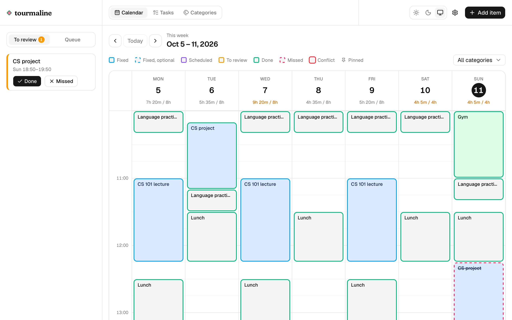
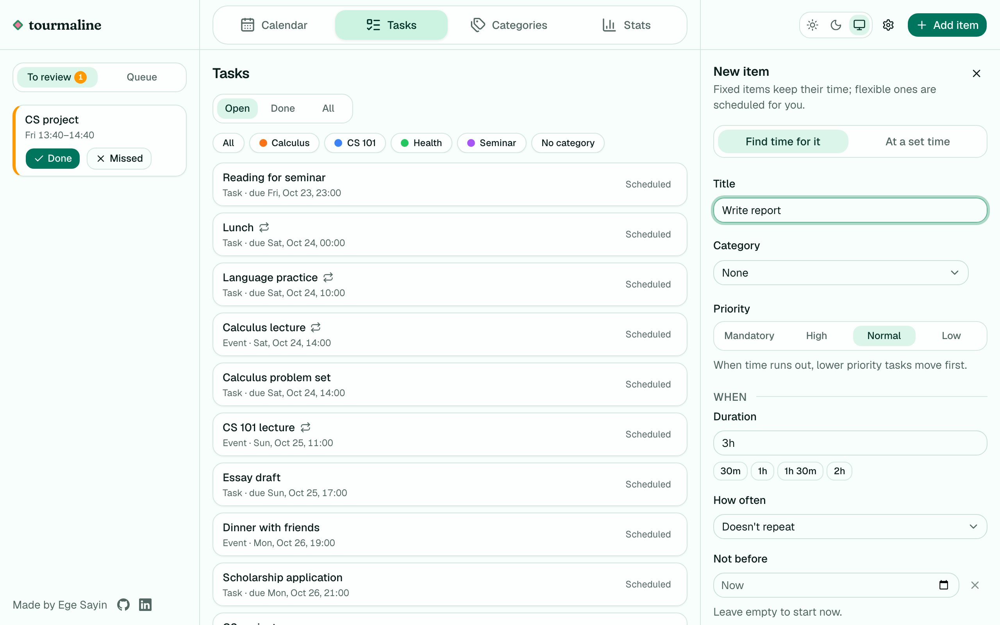
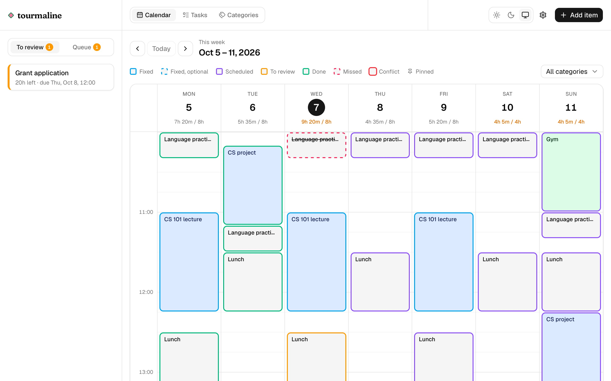
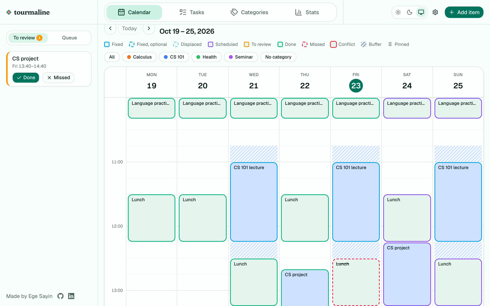

# Tourmaline

Tourmaline is a planner that does the planning for you. You give it your fixed schedule (classes, shifts, appointments)
and the tasks you need to get done, each with how long it takes and when it is due. It then finds time for every task,
and plans again whenever something changes. If you don't get to something, you mark it missed and Tourmaline finds it a
new time, so you never have to fix your week by hand.

<picture>
  <source media="(prefers-color-scheme: dark)" srcset="public/welcome/week-dark.jpg">
  
</picture>

_Events stay where you put them. Tasks fill the free time between them, each before its deadline._

## Try the demo

The public demo is at [tourmaline.sageland.dev](https://tourmaline.sageland.dev). You get your own copy of a sample
week to change as you like, with no sign-up, and nothing about you is stored. Your copy is deleted after 7 days without
a visit; if you want to keep your data, host it yourself (see [Self-hosting](#self-hosting)).

## Why I built it

Growing up, "have a planner" was the one suggestion I always heard. However, planners never worked for me, as I found it
hard to decide what I would do the next week. What if something comes up? What if I don't feel like it? It was even more
painful when I couldn't follow my plan, as then I not only had to plan my next week, but also find slots for the things
I couldn't do before. These reasons pushed me away from having a planner, but I also understand the value of one. Thus,
I wanted to build a planner that works for me, and hopefully for others as well. I built it around the idea that it
should be the scheduler that handles the thinking, not me. I should just provide my fixed schedule and the tasks I have,
and it should build the most optimal schedule around my preferences.

## How it plans

Everything in a week is either a fixed item or a task. Fixed items have fixed times, like a lecture, an appointment, or
a conference. So they are never moved by the scheduler. Tasks, on the other hand, are not bound to a fixed time slot, so
the scheduler moves them around to find the best-effort schedule with respect to the tasks' deadlines.

|                        | Fixed item                | Task                       |
| ---------------------- | ------------------------- | -------------------------- |
| Examples               | A lecture, an appointment | An assignment, the laundry |
| What you give it       | A start and an end        | A duration and a deadline  |
| Who picks its time     | You                       | The scheduler              |
| When something changes | It stays where it is      | It can be moved            |

<picture>
  <source media="(prefers-color-scheme: dark)" srcset="public/welcome/add-dark.jpg">
  
</picture>

_Give a task a length and a due date. Tourmaline picks the time, so you never hunt for a free slot._

Each task has a priority: mandatory, high, normal or low. The scheduler first tries to fit every task before its
deadline, moving already planned tasks around if that makes room. Only when that isn't possible does priority decide,
and the less important tasks give way. A task that still can't fit waits in the queue, so I see it days before its
deadline and can decide what to do with it.

<picture>
  <source media="(prefers-color-scheme: dark)" srcset="public/welcome/queue-dark.jpg">
  
</picture>

_Twenty hours of work due tomorrow won't fit. Instead of overbooking you, Tourmaline keeps it in the queue, so you know today._

Finally, the plan has to be stable. Once something is planned, it stays where it is unless another task needs its time.
So adding a task doesn't reshuffle my week, and neither does cancelling something. The time it leaves becomes free time,
or a task from the queue that fits takes it. Anything I have done, started or pinned never moves at all.

<picture>
  <source media="(prefers-color-scheme: dark)" srcset="public/welcome/missed-dark.jpg">
  
</picture>

_When a block doesn't happen, one click marks it missed and its time goes back into the plan, somewhere free before the deadline._

## The biggest design decision: a deterministic scheduler with ranked goals

The scheduler is deterministic, meaning the same tasks, fixed items and settings at the same moment always give the same
plan. Many planning solvers aren't, as they use random search or stop after a time limit, which is fine when a plan is
made once. However, Tourmaline plans again on every change, so a random scheduler could give me a different week every
time I save something, even when nothing important changed. Being deterministic also makes every plan reproducible, so a
bug can be tested at the exact moment it happened.

The other half of the decision is how the scheduler judges which plan is better. A common way is to give each goal a
weight and add them up. However, weights have to be tuned, and they can't guarantee that priority always wins, since
enough low priority tasks would eventually outweigh a mandatory one. Instead, Tourmaline ranks its goals and compares
plans one goal at a time, where a goal only matters when the plans tie on every goal before it:

1. Place every task.
2. Keep tasks out of the time of optional fixed items. An optional fixed item, like a gym session, gives way to a more
   important task that fits nowhere else.
3. Keep tasks within the hours they prefer.
4. Keep what is already planned where it is.

Within each goal, a more important task comes first.

Finding the best plan is NP-hard in general, so the scheduler doesn't try every option. It builds a first plan by
placing tasks one by one into the free time the earlier ones left. Then it tries to improve it. It moves planned tasks
out of the way of a task that didn't get what it needed, starting with the least important ones, places them again in
different orders, and keeps the result only if it is strictly better by the ranked goals. It repeats this until nothing
improves. The cost is that it can stop at a good plan rather than the best one.

The full reasoning, the alternatives I considered and the rest of the design are in [docs/design.md](docs/design.md).

## Self-hosting

You need a machine with Docker and Docker Compose; the image runs on both x86 and ARM. Several people can use one
instance, each with their own account and private data.

1. Copy [`deploy/compose.yaml`](deploy/compose.yaml) and [`deploy/.env.example`](deploy/.env.example) into a folder on
   the server, and create the `.env` file:

   ```bash
   cp .env.example .env
   ```

2. Set `POSTGRES_PASSWORD` in `.env` to a random string of letters and digits, for example from `openssl rand -hex 32`.
   Other characters break the database URL.

3. Start it:

   ```bash
   docker compose up -d
   ```

4. Open `http://<server>:3000` and create an account. The first account becomes the admin. After that, sign-up is closed
   until the admin opens it in Settings.

The settings in `.env`:

| Variable             | Default  | What it does                                                                    |
| -------------------- | -------- | ------------------------------------------------------------------------------- |
| `POSTGRES_PASSWORD`  | (none)   | The database password. Required.                                                |
| `PORT`               | `3000`   | The port the app listens on.                                                    |
| `TOURMALINE_VERSION` | `latest` | Which release to run. `latest` follows every new release; `1.2` stays on 1.2.x. |

**HTTPS.** Tourmaline doesn't handle HTTPS itself, so put a reverse proxy with HTTPS in front of it, such as Caddy or
nginx. The proxy has to send the `X-Forwarded-Proto` header; without it, sign-in cookies aren't marked secure. It also
has to pass the `Host` header through unchanged (Caddy does; in nginx, set `proxy_set_header Host $host;`), or the app
rejects every form as coming from another site.

**A forgotten password.** There is no email, so the server owner resets it:

```bash
docker compose exec app node cli/reset-password.mjs <username>
```

This prints a new random password and signs the account out everywhere. Its owner can then change it in Settings.

**Upgrading.** Pull the new image and restart; the database is updated automatically.

```bash
docker compose pull && docker compose up -d
```

**Backups.** Everything is in the Postgres database:

```bash
docker compose exec -T db pg_dump -U tourmaline tourmaline > tourmaline-backup.sql
```

## Development

You need Node 26 or later (the app uses the built-in Temporal API) and Docker for the development database.

```bash
npm run db:up                           # Postgres on localhost:5432
cp .env.example .env.local
npm install
npm run db:migrate
npm run db:seed -- <username> [password] # optional: the sample week
npm run dev
```

`db:seed` replaces the account's data with the sample week; give a password to create the account if it doesn't exist
yet. With `DEMO_MODE=true` in `.env.local`, the app runs as the public demo.

Checks:

```bash
npm run lint && npm run format:check
npx tsc --noEmit -p .
npm test                                # Vitest
npm run test:e2e                        # Playwright, on desktop and phone; serves the app on port 3100
```

Both test suites create their own databases (`TEST_DATABASE_URL`, `E2E_DATABASE_URL`), so they never touch your
development data.

The welcome page's screenshots are taken from the sample week by a script. Start the demo on port 3200, then run it:

```bash
DEMO_MODE=true NEXT_DEV_INDICATORS=off npx next dev -p 3200
npm run screenshots:welcome
```

## Releases

Pushing a version tag such as `v1.2.3` publishes the image to GitHub's container registry as `1.2.3`, `1.2` and
`latest`, for x86 and ARM. Pre-releases such as `v1.2.3-rc.1` get only their own tag.

## License

Tourmaline is licensed under the Apache License 2.0 with the Commons Clause. You can use it, change it and share it,
including at work. What you can't do is sell it, or a product or service whose value comes entirely or substantially
from it, which includes paid hosting or support. See [LICENSE](LICENSE).
